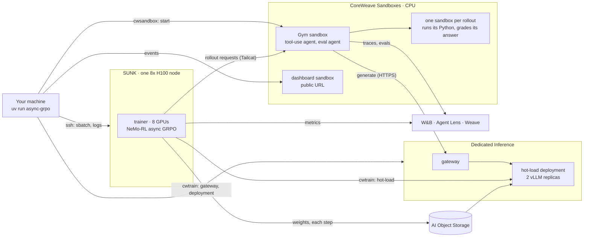

# async-grpo-tool-use: async GRPO with Python tool use on SUNK, Dedicated Inference and CoreWeave Sandboxes

```bash
cp .env.example .env              # fill in the three required values and WANDB_API_KEY
uv run async-grpo --max-num-steps 3
```

The first line it prints is the dashboard's public URL, about 2 seconds after the start. Send it to anyone; the page shows the run from its first bring-up step to its last eval.

Train [Qwen2.5-Math-7B](https://huggingface.co/Qwen/Qwen2.5-Math-7B) with async GRPO on [DAPO-Math-17k](https://huggingface.co/datasets/BytedTsinghua-SIA/DAPO-Math-17k), where the model can write and run Python while it solves each problem.

- **SUNK** (Slurm on CoreWeave): one 8x H100 node runs the [NeMo-RL](https://github.com/NVIDIA-NeMo/RL) v0.7.0 trainer in async GRPO mode.
- **CoreWeave Dedicated Inference**: a hot-load deployment (vLLM 0.30, 2 x 1 H100) serves the rollouts and loads new weights in the background while the trainer keeps training.
- **CoreWeave Sandboxes**: [NeMo-Gym](https://github.com/NVIDIA-NeMo/Gym) v0.6.0 runs in a CPU sandbox, and each rollout gets its own CPU sandbox to run its code in. One more small sandbox hosts the live dashboard.
- **W&B and Weave** (optional): trainer metrics in a W&B run, rollouts as Agent Lens traces, and every AIME-2024 eval as a Weave evaluation.

This recipe is based on the [`dapo-nemo-rl`](../dapo-nemo-rl/) recipe and reuses its launcher, hot-load backend and NeMo-RL patches.

## What this recipe shows

- Async GRPO in NeMo-RL: rollouts for the next step are generated while the current step trains, and hot-loads never block the trainer
- Tool-integrated reasoning: the model writes ` ```python ` blocks, the rollout's sandbox runs them, and the output goes back into the conversation
- One sandbox per rollout, from an elastic pool of serverless CPU sandboxes (256 by default)
- Checkpoint hot-load: each rank writes its share of the policy to node memory, `cwtrain` uploads it to CoreWeave AI Object Storage and swaps it into the running deployment
- A live dashboard served from a sandbox at a public HTTPS URL, read-only, with real rollouts to scroll through
- Agent Lens traces of sampled rollouts and per-problem Weave evaluations, logged from the Gym sandbox

## How it works



Each rollout:

1. NeMo-RL sends a math problem to the Gym agent `math_tir_agent`. Its resources server ([`gym_env/math_sandbox_eval/tir_app.py`](gym_env/math_sandbox_eval/tir_app.py)) takes a sandbox from the pool for this rollout.
2. The agent samples from the deployment. When the model ends a turn with a ` ```python ` block, the server saves it as a file in the rollout's sandbox, runs it, and returns the output as a tool result. Up to 4 code cells per rollout.
3. The final `\boxed{}` answer is graded with math-verify in the same sandbox. The reward is 1 for right, 0 for wrong. The sandbox goes back to the pool.

Each training step, the trainer trains on the finished rollouts while the next ones are generated, then exports the new weights. A background thread uploads them as a full snapshot and hot-loads them into both replicas, pausing and resuming the rollouts in flight. The trainer does not wait for it (`max_versions_behind: .inf` in [`config/grpo_async_qwen.yaml`](config/grpo_async_qwen.yaml)); each rollout is tagged with the weight version that produced it, and NeMo-RL's importance-sampling correction accounts for the age.

**Evaluation and calibration** use a second Gym agent, `math_eval_agent`, with the same tool use. Before step 1 the trainer checks the verifier on known-right and known-wrong answers. AIME-2024 (30 problems, 4 samples each) runs every 10 steps and at the end.

**Startup, token IDs, connections and NeMo-RL patches** work as in [`dapo-nemo-rl`](../dapo-nemo-rl/README.md#how-it-works). Patch `0003` adds async GRPO with background hot-loads to the `coreweave_hotload` backend.

## Prerequisites

- SSH access to a SUNK login node (for example a `sunk` alias in `~/.ssh/config`), a partition with 8x H100 nodes, and a directory on the shared filesystem (for example `/mnt/data/<you>`).
- A CoreWeave sandbox organization with CPU capacity for about 260 serverless sandboxes (1 CPU each), and permission to create a [managed runner](https://docs.coreweave.com/products/sandboxes/operations/managed-runners).
- A CoreWeave API access token from the [Tokens page](https://console.coreweave.com/tokens) with access to sandboxes and Inference (hot-load needs the Inference Admin role).
- [RL Rollouts](https://docs.coreweave.com/products/inference/rl-rollouts) (hot-load) enabled for your organization, and H100 capacity for Dedicated Inference in the gateway zone (default `US-WEST-04A`).
- A bucket for the model and the weight snapshots, with the same [bucket policy](https://docs.coreweave.com/products/inference/models#grant-inference-access-to-your-bucket) as `dapo-nemo-rl` under this recipe's prefix (default `cookbook/async-grpo-tool-use/`): read for the inference service, and `s3:PutObject`, `s3:GetObject`, `s3:ListBucket`, `s3:DeleteObject`, `s3:AbortMultipartUpload` for your organization's users. The launcher checks write access when it starts.
- `cwic` (logged in), `rsync`, Python 3.12-3.13 and [uv](https://docs.astral.sh/uv/).
- Optional, recommended: a [W&B](https://wandb.ai) API key. Without it the run and the dashboard work, with no W&B, Agent Lens or Weave links.

The first run imports the NeMo-RL image on SUNK, which takes about 50 minutes, and uploads the model to the bucket. Later runs use the caches.

## Setup

1. Create a sandbox runner. It runs the Gym sandbox:

   ```bash
   cp infra/runner.yaml.example infra/runner.yaml   # fill in runner_id, zone, cluster_id
   cwic sandbox runner create <runner-id> -f infra/runner.yaml
   cwic sandbox runner describe <runner-id>         # wait for READY and CONNECTED
   ```

2. Configure. `.env.example` documents every setting; only `CWSANDBOX_API_KEY`, `CWSANDBOX_RUNNER_ID` and `SUNK_DATA_DIR` are required.

   ```bash
   cp .env.example .env    # fill in
   ssh sunk sinfo -p h100                   # check SUNK access
   cwic inference deployment parameters     # check Dedicated Inference access
   ```

## Run

```bash
uv run async-grpo --max-num-steps 3
```

`uv run` installs the launcher on first use. Expected output (abridged):

```
[dashboard] https://8080-<sandbox id>.<hash>.ep1.cwsandbox.com  (read-only, shareable)
[dashboard] http://localhost:8766  (this machine)
[dashboard] W&B run: https://forge.coreweave.com/wandb/<entity>/async-grpo-tool-use/runs/async-grpo-...
[dashboard] Agent Lens traces: https://forge.coreweave.com/wandb/<entity>/async-grpo-tool-use/weave/agents
[dashboard] Weave evaluations: https://forge.coreweave.com/wandb/<entity>/async-grpo-tool-use/weave/evaluations
[grpo] storage: temporary access key can write s3://gradient-hotloading/cookbook/async-grpo-tool-use/runs/...
[grpo] inference: gateway ... ready at https://async-grpo-....gw.cwinference.com
[grpo] gym: sandbox ... requested (CPU)
[grpo] sunk: job ... submitted (/mnt/data/<you>/async-grpo-tool-use/runs/async-grpo-...)
[grpo] inference: deployment ready
[grpo] trainer: starting async GRPO on 8 GPUs, rollouts from https://async-grpo-....gw.cwinference.com/v1
========================= Step 1/3 =========================
...
[grpo] trainer exited with 0
[grpo] inference: deployment ... deleted
[grpo] storage: access key revoked
[dashboard] still up at https://8080-<sandbox id>...; Ctrl+C stops it
```

- Remove `--max-num-steps` for a 20-step run. Pass NeMo-RL overrides after `--`, for example `uv run async-grpo -- grpo.num_prompts_per_step=32`.
- `--no-share` keeps the dashboard on `localhost` only.
- `python -m async_grpo_tool_use.launch` runs the same training without any dashboard.
- A `PythonFinalizationError` traceback at the end comes from NeMo-RL's shutdown. It does not mean the run failed.

## What you see

**The dashboard.** The top of the page fits one screen:

- the bring-up step that is running (storage key, gateway, Gym sandbox, Slurm job, deployment, rollout sandboxes, verifier check), then the step, average reward, how busy the trainer's GPUs are, and how many sandboxes have started;
- three cards and charts: trainer GPU utilization, rollout sandboxes (running, in use, rollouts waiting), and the sampler's tokens/s and weights version;
- "Where the time goes": a timeline of training, weight sync, rollouts in flight and sandboxes running code, which shows the async overlap;
- a table of steps with NeMo-RL's own timings, reward and generation KL error.

Below the fold, **Examples** lists the latest 30 finished rollouts, right and wrong: the problem, each turn of the model's reasoning, every code cell with its output, the extracted answer and the expected one.

The header links the W&B run, the Agent Lens traces and the Weave evaluations. They open with a W&B login; the dashboard itself needs none.

**W&B run** (`<entity>/async-grpo-tool-use`, named after the run tag): NeMo-RL's training metrics, rewards, step timings and validation accuracy.

**Agent Lens traces**: one conversation per traced rollout, with each model call and each code cell as a span, and the reward, expected answer and extracted answer as attributes. Every eval rollout is traced, and 1 in 16 training rollouts (`AGENT_LENS_SAMPLE`).

**Weave evaluations**: one evaluation per AIME-2024 round, named `aime-2024-step-<N>`, with a row per sample (problem, model answer, `correct`) and the round's accuracy.

The W&B key reaches the trainer through the run's secrets file on SUNK and the Gym sandbox through its environment, never through the dashboard. The dashboard sandbox gets only scrubbed events: the relay removes tokens, keys, internal addresses and home directories before it sends them.

## Measured timings

One run of `uv run async-grpo --max-num-steps 3` (128 rollouts per step, 2 replicas, a pool of 128 rollout sandboxes, cached image and model):

| Phase | Time |
|---|---|
| Dashboard URL printed | 1.6 s after the viewer sandbox is requested; the page answers at 4.0 s |
| Start to step 1 | 8 min 20 s: deployment ready at 5 min 25 s (2 min 30 s after it is requested), verifier check done at 6 min 25 s, first batch of rollouts about 2 min |
| Steps 1 and 2 | 35 s and 48 s |
| Step 3, with the AIME-2024 eval | 176 s: generate 61 s, train 11 s, validate 20 s, and 62 s that NeMo-RL does not break down |
| Weight export, per step | 22 s, on the trainer |
| Upload and hot-load, per step | 50 to 61 s, in the background (upload 14 s, swap into the replicas 36 to 47 s) |
| Cleanup after the trainer exits | 4 min 40 s, mostly the deployment delete |
| Whole run | 18 min 30 s |
| First image import on SUNK (once) | about 50 minutes |

In a longer run of the same trainer code, steps 2 to 5 took 103 to 106 s each with export 22 s and upload plus hot-load about 70 s in the background, and the trainer's GPUs were training about 78% of each step. At 3 steps the trainer is mostly waiting for rollouts, so short runs show much lower GPU use.

## Cleanup

When the run ends, fails or is interrupted, the launcher deletes what it created:

- the Slurm job, and the tokens, keys and endpoints in its run directory (the logs stay)
- the Gym sandbox and the rollout sandboxes
- the deployment, then the gateway
- the run's objects in the bucket (`<prefix>/runs/<run-tag>/`: model copy and snapshots)
- the temporary storage key

The dashboard sandbox stays up with the results until you press Ctrl+C, or until `DASHBOARD_HOURS` (default 12) after the start. The W&B run, traces and evaluations stay in W&B.

If a step fails, the launcher prints the command to run instead. To clean up after an earlier run:

```bash
uv run python -m async_grpo_tool_use.cleanup --tag <run-tag>             # sandboxes of one run
uv run python -m async_grpo_tool_use.cleanup --tag <run-tag>-dashboard   # its dashboard
uv run python -m async_grpo_tool_use.cleanup --all                       # every run and dashboard
ssh sunk scancel --name=<run-tag>                                        # its Slurm job
cwic inference deployment list                      # then: cwic inference deployment delete <id>
cwic inference gateway list                         # then: cwic inference gateway delete <id>
```

Delete the runner when you no longer need it: `cwic sandbox runner delete <runner-id> --yes`. Remove `<SUNK_DATA_DIR>/async-grpo-tool-use/` on SUNK and `<prefix>/models/` in the bucket to free the caches.

## Limits

- **Hot-load is in preview** and must be enabled for the organization.
- **Stale rollouts.** Async GRPO trains on rollouts from weights up to a few versions old. NeMo-RL corrects for it with importance sampling, but it is not the same as on-policy GRPO.
- **Full snapshots.** Each step uploads the full 14 GiB checkpoint. Async GRPO hides this from the trainer, at the cost of staler rollouts.
- **Rollout code runs as written** inside its sandbox, with 15 seconds per cell. Sandboxes isolate rollouts from each other and from the trainer, and the working directory is reset between rollouts.
- **Tool calls are read from text.** The deployment drops the ` ``` ` stop sequence, so the server finds code blocks in the model's text instead of relying on stop tokens.
- **The dashboard URL is public.** Anyone with it can watch the run; nobody can change it. Stop it with Ctrl+C or the cleanup command when you are done.
- **Eval step labels are inferred.** The Gym server does not know the trainer's step; it labels eval rounds by order, every `val_period` steps and at the last one.
- **Tailcat is experimental**, and **Gym has no authentication**, as in `dapo-nemo-rl`.

## Tests

```bash
uv run --extra dev pytest -q
```

The tests use fakes for the sandbox SDK, the SUNK login node, `cwic`, the `cwtrain` client, object storage, W&B and Weave. Set `NEMO_RL_SRC` to a NeMo-RL v0.7.0 checkout to also check that the patches apply.

## Layout

```
async_grpo_tool_use/run.py          the one command: dashboard, then the launcher
async_grpo_tool_use/launch.py       start the run: storage key, gateway, Gym sandbox, SUNK job, deployment, cleanup
async_grpo_tool_use/dashboard/      the live page: local server, log parser, viewer sandbox and relay
async_grpo_tool_use/inference.py    gateway and hot-load deployment (cwtrain), storage key (cwic)
async_grpo_tool_use/caios.py        object storage upload, copy and delete
async_grpo_tool_use/hotload.py      snapshot files for hot-load
async_grpo_tool_use/sunk.py         ssh and Slurm helpers for the SUNK login node
async_grpo_tool_use/sunk_job.py     Slurm batch script: image import, tunnel, trainer step
async_grpo_tool_use/tunnel.py       Tailcat install, serve and forward
async_grpo_tool_use/run_trainer.py  trainer step: patch NeMo-RL, stage the model, calibrate, run async GRPO
async_grpo_tool_use/run_gym.py      Gym sandbox: install and start NeMo-Gym
async_grpo_tool_use/nemo_rl_ext/    the coreweave_hotload backend for NeMo-RL, with background hot-load
async_grpo_tool_use/calibrate.py    verifier calibration cases and report
async_grpo_tool_use/dapo_data.py    DAPO-Math-17k and AIME-2024 to NeMo-Gym rows with the Python tool
async_grpo_tool_use/model_prep.py   model download
async_grpo_tool_use/procs.py        process helpers for the entrypoints
async_grpo_tool_use/cleanup.py      stop sandboxes by tag
gym_env/token_ids_model.py          Gym model server: token IDs in, token IDs out
gym_env/math_sandbox_eval/          Gym servers: tool use (tir_app.py), eval and calibration (app.py), cwsandbox provider, Agent Lens and Weave logging (forge.py)
config/                             NeMo-RL config
patches/                            NeMo-RL v0.7.0 patches
infra/runner.yaml.example           sandbox runner and policy
```
