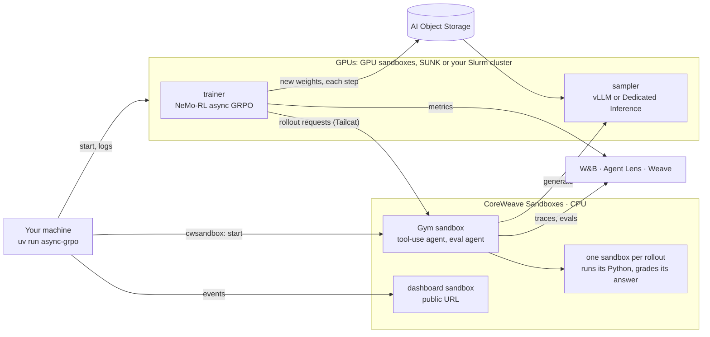

# async-grpo-tool-use: async GRPO with Python tool use on CoreWeave Sandboxes

Train a Qwen2.5-Math model with async GRPO on [DAPO-Math-17k](https://huggingface.co/datasets/BytedTsinghua-SIA/DAPO-Math-17k). The model writes and runs Python while it solves each problem: every rollout runs its code in its own CoreWeave sandbox. A live dashboard at a public URL shows the run from its first bring-up step to its last eval.

## Set up

```bash
git clone https://github.com/coreweave/cwsandbox-recipes.git && cd cwsandbox-recipes/recipes/async-grpo-tool-use && cp .env.example .env
```

In `.env`, set `CWSANDBOX_API_KEY` (a CoreWeave API access token from the [Tokens page](https://console.coreweave.com/tokens)) and, optionally, `WANDB_API_KEY` for the W&B run, Agent Lens traces and Weave evals. This part is the same wherever the GPUs run: [NeMo-Gym](https://github.com/NVIDIA-NeMo/Gym) and the rollout sandboxes always run on CoreWeave Sandboxes, serverless.

## Choose where the GPUs run

Add the lines for one option to `.env`:

**1. GPU sandboxes.** No cluster. A 1.5B model, one serverless GPU sandbox for the trainer and one per sampler.

```bash
TRAINER=sandbox
SAMPLER=vllm
SAMPLER_REPLICAS=2              # samplers, one GPU sandbox each
HOTLOAD_BUCKET=<your bucket>    # carries the new weights to the samplers
```

**2. SUNK + Dedicated Inference.** A 7B model on one 8x H100 SUNK node; a Dedicated Inference deployment serves the rollouts and hot-loads each new checkpoint.

```bash
SUNK_SSH_HOST=<login node>      # ssh host or ~/.ssh/config alias
SUNK_DATA_DIR=/mnt/data/<you>
HOTLOAD_BUCKET=<your bucket>
```

**3. Bring your own compute.** Any Slurm cluster with pyxis. A 7B model; the trainer and a vLLM sampler share one 8-GPU node. No Inference access or bucket.

```bash
TRAINER=sunk
SAMPLER=vllm
SUNK_SSH_HOST=<login node>
SUNK_DATA_DIR=<shared directory>
```

Then run:

```bash
uv run async-grpo --max-num-steps 3
```

The first line it prints is the dashboard's public URL, about 2 seconds after the start. Send it to anyone. [Prerequisites](#prerequisites) lists what each option needs.

## What this recipe shows

- Async GRPO in [NeMo-RL](https://github.com/NVIDIA-NeMo/RL) v0.7.0: rollouts for the next step are generated while the current step trains, and new weights reach the sampler without blocking the trainer
- Tool-integrated reasoning: the model writes ` ```python ` blocks, the rollout's sandbox runs them, and the output goes back into the conversation
- One sandbox per rollout, from an elastic pool of serverless CPU sandboxes (256 by default)
- Three places for the GPUs, with the same Gym, rollout sandboxes and dashboard
- A live dashboard served from a sandbox at a public HTTPS URL, read-only, with real rollouts to scroll through
- W&B metrics, Agent Lens traces of sampled rollouts and per-problem Weave evaluations

This recipe is based on the [`dapo-nemo-rl`](../dapo-nemo-rl/) recipe and reuses its launcher, hot-load backend and NeMo-RL patches.

## How it works



Each rollout:

1. NeMo-RL sends a math problem to the Gym agent `math_tir_agent`. Its resources server ([`gym_env/math_sandbox_eval/tir_app.py`](gym_env/math_sandbox_eval/tir_app.py)) takes a sandbox from the pool for this rollout.
2. The agent samples from the sampler. When the model ends a turn with a ` ```python ` block, the server saves it as a file in the rollout's sandbox, runs it, and returns the output as a tool result. Up to 4 code cells per rollout.
3. The final `\boxed{}` answer is graded with math-verify in the same sandbox. The reward is 1 for right, 0 for wrong. The sandbox goes back to the pool.

Each training step, the trainer trains on the finished rollouts while the next ones are generated, then exports the new weights. A background thread sends them to the sampler, which pauses the rollouts in flight, swaps the weights and resumes them. The trainer does not wait for it (`max_versions_behind: .inf` in [`config/grpo_async_qwen.yaml`](config/grpo_async_qwen.yaml)); each rollout is tagged with the weight version that produced it, and NeMo-RL's importance-sampling correction accounts for the age.

**Evaluation and calibration** use a second Gym agent, `math_eval_agent`, with the same tool use. Before step 1 the trainer checks the verifier on known-right and known-wrong answers. AIME-2024 (30 problems, 4 samples each) runs every 10 steps and at the end.

**Startup, token IDs, connections and NeMo-RL patches** work as in [`dapo-nemo-rl`](../dapo-nemo-rl/README.md#how-it-works). Patch `0003` adds async GRPO with background weight updates to the `coreweave_hotload` backend.

### The three options

| Option | `TRAINER` | `SAMPLER` | Trainer | Sampler | New weights reach the sampler through |
|---|---|---|---|---|---|
| 1. GPU sandboxes | `sandbox` | `vllm` | one serverless GPU sandbox | `SAMPLER_REPLICAS` GPU sandboxes (default 1), one vLLM each | object storage: the trainer uploads each export once, every sampler downloads it |
| 2. SUNK + Dedicated Inference | `sunk` (default) | `di` (default) | Slurm job on one 8x H100 node | Dedicated Inference hot-load deployment (vLLM, 2 x 1 H100) | object storage, then a hot-load |
| 3. Bring your own compute | `sunk` | `vllm` | Slurm job on part of a node | vLLM as a second job step on the same node (`SAMPLER_GPUS`, default 4) | node memory, loaded in place |

**GPU sandboxes** suit small models: each trainer and sampler fits on one GPU. The default model is [Qwen2.5-Math-1.5B](https://huggingface.co/Qwen/Qwen2.5-Math-1.5B) (`MODEL_REPO`) on `rtxp6000-8x` (`GPU_SANDBOX_TYPE`). More samplers generate rollouts faster; the trainer stays on one GPU, since training across sandboxes would need NCCL between them.

**SUNK + Dedicated Inference** and **Bring your own compute** train [Qwen2.5-Math-7B](https://huggingface.co/Qwen/Qwen2.5-Math-7B). Option 3 works on any Slurm cluster with [pyxis](https://github.com/NVIDIA/pyxis) and enroot, not only SUNK; the settings keep the `SUNK_` prefix.

The self-hosted sampler (`async_grpo_tool_use/sampler.py`) is vLLM in dev mode with a small weight receiver. To load new weights it pauses the requests in flight, reloads the weights, resets the prefix cache and resumes, so rollouts continue on the new weights. Only the receiver's load request goes through the Tailcat tunnel; the weights go through object storage or node memory, because the tunnel is too slow for gigabytes.

**Off-policy.** The dashboard's "Off-policy" value (and `step/off_policy` in W&B) is how many steps old the trained rollouts were: NeMo-RL's average trajectory age plus the versions the sampler still lagged behind the trainer when the step sampled its batch.

## Prerequisites

For every option:

- A CoreWeave sandbox organization with a [concurrent sandbox quota](https://docs.coreweave.com/products/sandboxes/reference/limits-and-quotas) of about 260 (256 rollout sandboxes, 1 CPU each, plus Gym, dashboard and GPU sandboxes; lower `SANDBOX_POOL_MIN`, `SANDBOX_POOL_MAX` and `GYM_REMOTE_CONCURRENCY` for a smaller quota), and a CoreWeave API access token with access to sandboxes.
- Python 3.12-3.13 and [uv](https://docs.astral.sh/uv/).
- Optional, recommended: a [W&B](https://wandb.ai) API key. Without it the run and the dashboard work, with no W&B, Agent Lens or Weave links.

**1. GPU sandboxes**

- Serverless GPU capacity for 1 + `SAMPLER_REPLICAS` sandboxes.
- A bucket in CoreWeave AI Object Storage with `s3:PutObject`, `s3:GetObject`, `s3:ListBucket`, `s3:DeleteObject` and `s3:AbortMultipartUpload` for your organization's users under the recipe's prefix (`HOTLOAD_BUCKET_PREFIX`, default `cookbook/async-grpo-tool-use/`). The launcher checks write access when it starts.
- `cwic` (logged in), for the run's temporary storage key.

**2. SUNK + Dedicated Inference**

- SSH access to a SUNK login node, a partition with 8x H100 nodes (`SUNK_PARTITION`, default `h100`), and a directory on the shared filesystem.
- [RL Rollouts](https://docs.coreweave.com/products/inference/rl-rollouts) (hot-load) enabled for your organization, the Inference Admin role on your token, and H100 capacity for Dedicated Inference in the gateway zone (`INFERENCE_ZONE`, default `US-WEST-04A`).
- A bucket for the model and the weight snapshots, with the same [bucket policy](https://docs.coreweave.com/products/inference/getting-started#grant-inference-access-to-your-bucket) as `dapo-nemo-rl` under this recipe's prefix: read for the inference service, and the write permissions above for your organization's users.
- `cwic` (logged in) and `rsync`.

**3. Bring your own compute**

- SSH access to a login node of a Slurm cluster with pyxis and enroot, a partition with 8-GPU nodes, and a shared filesystem for `SUNK_DATA_DIR`.
- Outbound internet from the nodes: the NeMo-RL image, the model and the Tailcat relay.
- `rsync`.

The first run on Slurm imports the NeMo-RL image, which takes about 50 minutes. GPU sandboxes pull the image in about 5 minutes. Later runs use the caches.

To place the Gym and rollout sandboxes on your own CKS cluster instead of serverless, create a [sandbox runner](https://docs.coreweave.com/products/sandboxes/operations/managed-runners) from [`infra/runner.yaml.example`](infra/runner.yaml.example) and set `CWSANDBOX_RUNNER_ID` (and `SANDBOX_PLACEMENT=cks` for the rollout sandboxes).

## Run

```bash
uv run async-grpo --max-num-steps 3
```

`uv run` installs the launcher on first use. Expected output with option 2 (abridged):

```
[dashboard] https://8080-<sandbox id>.<hash>.ep1.cwsandbox.com  (read-only, shareable)
[dashboard] http://localhost:8766  (this machine)
[dashboard] W&B run: https://forge.coreweave.com/wandb/<entity>/async-grpo-tool-use/runs/async-grpo-...
[dashboard] W&B: page metrics: https://forge.coreweave.com/wandb/<entity>/async-grpo-tool-use/runs/async-grpo-...-dashboard
[dashboard] Agent Lens: https://forge.coreweave.com/wandb/<entity>/async-grpo-tool-use/weave/agents
[dashboard] Weave evals: https://forge.coreweave.com/wandb/<entity>/async-grpo-tool-use/weave/evaluations
[grpo] storage: temporary access key can write s3://<bucket>/cookbook/async-grpo-tool-use/runs/...
[grpo] inference: gateway ... ready at https://async-grpo-....gw.cwinference.com
[grpo] gym: sandbox ... requested (CPU)
[grpo] sunk: job ... submitted (/mnt/data/<you>/async-grpo-tool-use/runs/async-grpo-...)
[grpo] inference: deployment ready
[grpo] trainer: starting async GRPO on 8 GPUs, rollouts from https://async-grpo-....gw.cwinference.com/v1
========================= Step 1/3 =========================
...
[grpo] trainer exited with 0
[grpo] inference: deployment ... deleted
[grpo] storage: access key revoked
[dashboard] still up at https://8080-<sandbox id>...; Ctrl+C stops it
```

With option 1, the gateway, Slurm and deployment lines are replaced by `trainer: sandbox ... requested (1 GPU)` and `sampler-<i>: sandbox ... requested (1 GPU)`, and each step logs `hot-load vN: ... upload and load Ns`.

- Remove `--max-num-steps` for a 20-step run. Pass NeMo-RL overrides after `--`, for example `uv run async-grpo -- grpo.num_prompts_per_step=32`.
- `--no-share` keeps the dashboard on `localhost` only.
- `python -m async_grpo_tool_use.launch` runs the same training without any dashboard.
- A `PythonFinalizationError` traceback at the end comes from NeMo-RL's shutdown. It does not mean the run failed.
- With `SAMPLER=vllm`, a `VLLMValidationError: This model's maximum context length is 3072 tokens` traceback from a sampler is a rollout that ran past the context limit. Gym ends that rollout and training continues.

## What you see

**The dashboard.** The top of the page fits one screen:

- the bring-up step that is running (for example storage key, Gym sandbox, Slurm job or GPU sandboxes, deployment, rollout sandboxes, verifier check), then the step, average reward, how busy the trainer's GPUs are, and how many sandboxes have started;
- three cards and charts: trainer GPU utilization, rollout sandboxes (running, in use, rollouts waiting), and the sampler's tokens/s and weights version;
- "Where the time goes": a timeline of training, weight sync, rollouts in flight and sandboxes running code, which shows the async overlap;
- a table of steps with NeMo-RL's own timings, reward and generation KL error.

Below the fold, **Examples** lists the latest 30 finished rollouts, right and wrong: the problem, each turn of the model's reasoning, every code cell with its output, the extracted answer and the expected one.

The header links the W&B run, the Agent Lens traces and the Weave evaluations. They open with a W&B login; the dashboard itself needs none.

**W&B run** (`<entity>/async-grpo-tool-use`, named after the run tag): NeMo-RL's training metrics, rewards, step timings and validation accuracy.

**W&B dashboard metrics** (`<run tag>-dashboard`, in the same W&B group as the run): what the dashboard draws. `live/*` against `live/elapsed_s`: trainer GPU utilization, sampler tokens/s and requests in flight, the rollout sandbox pool, sandbox counts. `step/*` against `step/step`: each step's metrics and timings, `step/off_policy`, hot-load times and AIME accuracy. It is a separate run because a second writer on the trainer's run would renumber NeMo-RL's steps.

**Agent Lens traces**: one conversation per traced rollout, with each model call and each code cell as a span, and the reward, expected answer and extracted answer as attributes. Every eval rollout is traced, and 1 in 16 training rollouts (`AGENT_LENS_SAMPLE`).

**Weave evaluations**: one evaluation per AIME-2024 round, named `aime-2024-step-<N>`, with a row per sample (problem, model answer, `correct`) and the round's accuracy.

The W&B key reaches the trainer through the run's secrets file on Slurm (or its sandbox's environment) and the Gym sandbox through its environment, never through the dashboard. The dashboard sandbox gets only scrubbed events: the relay removes tokens, keys, internal addresses and home directories before it sends them.

## Measured timings

**1. GPU sandboxes**, one run of 10 steps with 3 samplers (Qwen2.5-Math-1.5B, `rtxp6000-8x`, AIME-2024 at steps 5 and 10):

| Phase | Time |
|---|---|
| Start to training | about 7 minutes: about 5 for the GPU sandboxes to pull the NeMo-RL image, 2 more for vLLM to serve |
| Steps without eval | 38 to 42 s (training about 26 s) |
| Steps with the AIME-2024 eval | 73 to 77 s |
| New weights to all samplers, per step | 7 to 9 s for 2.9 GiB, in the background (upload 3 to 4 s, download 3 to 5 s, swap 1 s) |
| Off-policy | 2 steps, 1 when the samplers caught up |

**2. SUNK + Dedicated Inference**, one run of `uv run async-grpo --max-num-steps 3` (128 rollouts per step, 2 replicas, a pool of 128 rollout sandboxes, cached image and model):

| Phase | Time |
|---|---|
| Dashboard URL printed | 1.6 s after the viewer sandbox is requested; the page answers at 4.0 s |
| Start to step 1 | 8 min 20 s: deployment ready at 5 min 25 s (2 min 30 s after it is requested), verifier check done at 6 min 25 s, first batch of rollouts about 2 min |
| Steps 1 and 2 | 35 s and 48 s |
| Step 3, with the AIME-2024 eval | 176 s: generate 61 s, train 11 s, validate 20 s, and 62 s that NeMo-RL does not break down |
| Weight export, per step | 22 s, on the trainer |
| Upload and hot-load, per step | 50 to 61 s, in the background (upload 14 s, swap into the replicas 36 to 47 s) |
| Cleanup after the trainer exits | 4 min 40 s, mostly the deployment delete |
| Whole run | 18 min 30 s |
| First image import on SUNK (once) | about 50 minutes |

In a longer run of the same trainer code, steps 2 to 5 took 103 to 106 s each with export 22 s and upload plus hot-load about 70 s in the background, and the trainer's GPUs were training about 78% of each step. At 3 steps the trainer is mostly waiting for rollouts, so short runs show much lower GPU use.

## Cleanup

When the run ends, fails or is interrupted, the launcher deletes what it created:

- the Slurm job, and the tokens, keys and endpoints in its run directory (the logs stay), or the trainer and sampler GPU sandboxes
- the Gym sandbox and the rollout sandboxes
- the deployment, then the gateway
- the run's objects in the bucket (`<prefix>/runs/<run-tag>/`: model copy, snapshots and weight exports)
- the temporary storage key

The dashboard sandbox stays up with the results until you press Ctrl+C, or until `DASHBOARD_HOURS` (default 12) after the start. The W&B run, traces and evaluations stay in W&B.

If a step fails, the launcher prints the command to run instead. To clean up after an earlier run:

```bash
uv run python -m async_grpo_tool_use.cleanup --tag <run-tag>             # sandboxes of one run, GPU ones too
uv run python -m async_grpo_tool_use.cleanup --tag <run-tag>-dashboard   # its dashboard
uv run python -m async_grpo_tool_use.cleanup --all                       # every run and dashboard
ssh sunk scancel --name=<run-tag>                                        # its Slurm job
cwic inference deployment list                      # then: cwic inference deployment delete <id>
cwic inference gateway list                         # then: cwic inference gateway delete <id>
```

If you created a runner, delete it when you no longer need it: `cwic sandbox runner delete <runner-id> --yes`. Remove `<SUNK_DATA_DIR>/async-grpo-tool-use/` on SUNK and `<prefix>/models/` in the bucket to free the caches.

## Limits

- **Hot-load is in preview** and must be enabled for the organization (option 2).
- **Stale rollouts.** Async GRPO trains on rollouts from weights up to a few versions old. NeMo-RL corrects for it with importance sampling, but it is not the same as on-policy GRPO.
- **Full snapshots.** Each step sends the full checkpoint (14 GiB for 7B, 2.9 GiB for 1.5B). Async GRPO hides this from the trainer, at the cost of staler rollouts.
- **One GPU per trainer sandbox.** With option 1 the trainer does not span sandboxes; use option 2 or 3 for models that need a full node.
- **Rollout code runs as written** inside its sandbox, with 15 seconds per cell. Sandboxes isolate rollouts from each other and from the trainer, and the working directory is reset between rollouts.
- **Tool calls are read from text.** The deployment drops the ` ``` ` stop sequence, so the server finds code blocks in the model's text instead of relying on stop tokens.
- **The dashboard URL is public.** Anyone with it can watch the run; nobody can change it. Stop it with Ctrl+C or the cleanup command when you are done.
- **Eval step labels are inferred.** The Gym server does not know the trainer's step; it labels eval rounds by order, every `val_period` steps and at the last one.
- **Tailcat is experimental**, and **Gym has no authentication**, as in `dapo-nemo-rl`.

## Tests

```bash
uv run --extra dev pytest -q
```

The tests use fakes for the sandbox SDK, the SUNK login node, `cwic`, the `cwtrain` client, object storage, W&B and Weave. Set `NEMO_RL_SRC` to a NeMo-RL v0.7.0 checkout to also check that the patches apply.

## Layout

```
async_grpo_tool_use/run.py          the one command: dashboard, then the launcher
async_grpo_tool_use/launch.py       start the run: storage key, gateway, Gym sandbox, Slurm job or GPU sandboxes, deployment, cleanup
async_grpo_tool_use/dashboard/      the live page: local server, log parser, viewer sandbox and relay
async_grpo_tool_use/inference.py    gateway and hot-load deployment (cwtrain), storage key (cwic)
async_grpo_tool_use/caios.py        object storage upload, copy and delete
async_grpo_tool_use/hotload.py      snapshot files for hot-load
async_grpo_tool_use/sunk.py         ssh and Slurm helpers for the SUNK login node
async_grpo_tool_use/sunk_job.py     Slurm batch script: image import, tunnel, trainer step, sampler step
async_grpo_tool_use/trainer_sandbox.py GPU sandbox entrypoint of the trainer (TRAINER=sandbox)
async_grpo_tool_use/sampler.py      self-hosted vLLM sampler and its weight receiver (SAMPLER=vllm)
async_grpo_tool_use/tunnel.py       Tailcat install, serve and forward
async_grpo_tool_use/run_trainer.py  trainer step: patch NeMo-RL, stage the model, calibrate, run async GRPO
async_grpo_tool_use/run_gym.py      Gym sandbox: install and start NeMo-Gym
async_grpo_tool_use/nemo_rl_ext/    the coreweave_hotload backend for NeMo-RL, with background hot-load
async_grpo_tool_use/calibrate.py    verifier calibration cases and report
async_grpo_tool_use/dapo_data.py    DAPO-Math-17k and AIME-2024 to NeMo-Gym rows with the Python tool
async_grpo_tool_use/model_prep.py   model download
async_grpo_tool_use/procs.py        process helpers for the entrypoints
async_grpo_tool_use/cleanup.py      stop sandboxes by tag
gym_env/token_ids_model.py          Gym model server: token IDs in, token IDs out
gym_env/math_sandbox_eval/          Gym servers: tool use (tir_app.py), eval and calibration (app.py), cwsandbox provider, Agent Lens and Weave logging (forge.py)
config/                             NeMo-RL config
patches/                            NeMo-RL v0.7.0 patches
infra/runner.yaml.example           optional sandbox runner and policy, to run the sandboxes on your CKS cluster
```
