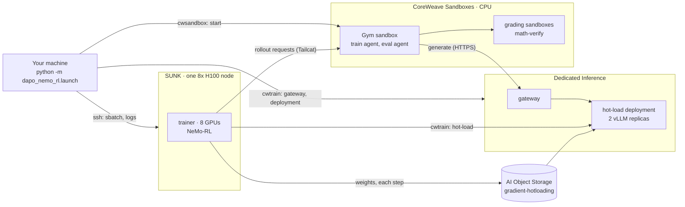

# dapo-nemo-rl: DAPO training with SUNK, Dedicated Inference and CoreWeave Sandboxes

Train [Qwen2.5-Math-7B](https://huggingface.co/Qwen/Qwen2.5-Math-7B) with DAPO on [DAPO-Math-17k](https://huggingface.co/datasets/BytedTsinghua-SIA/DAPO-Math-17k).

- **SUNK** (Slurm on CoreWeave): one 8x H100 node runs the [NeMo-RL](https://github.com/NVIDIA-NeMo/RL) v0.7.0 trainer.
- **CoreWeave Dedicated Inference**: a hot-load deployment (vLLM 0.30, 2 x 1 H100) serves the rollouts and gets new weights after every step.
- **CoreWeave Sandboxes**: [NeMo-Gym](https://github.com/NVIDIA-NeMo/Gym) v0.6.0 runs in a CPU sandbox. Its evaluation server grades answers in more CPU sandboxes.

## What this recipe shows

- RL training on SUNK with rollouts from a Dedicated Inference deployment
- Checkpoint hot-load: the trainer uploads each new policy to CoreWeave AI Object Storage and swaps it into the running deployment
- [`cwtrain`](https://pypi.org/project/cwtrain/) creates the gateway and the deployment and runs every hot-load; `cwic` creates a temporary storage key. The launcher deletes all of them at the end
- NeMo-Gym's sandbox API with a CoreWeave provider: evaluation and verifier calibration run in CPU sandboxes
- DAPO in NeMo-RL: clip-higher, dynamic sampling, token-level loss, overlong reward shaping

## How it works



Each training step:

1. **Send weights.** The trainer exports the policy (14 GiB). `cwtrain`'s `HotLoader` uploads it as a full snapshot to the bucket and hot-loads it into both replicas. The trainer waits until every replica serves it.
2. **Roll out.** NeMo-RL sends each math problem to the Gym training agent. Gym samples answers from the deployment and scores them with math-verify.
3. **Train.** NeMo-RL runs a GRPO step with the DAPO settings in [`config/grpo_dapo_qwen.yaml`](config/grpo_dapo_qwen.yaml).

Evaluation and calibration use a second Gym agent, `math_eval_agent`. Its server ([`gym_env/math_sandbox_eval/`](gym_env/math_sandbox_eval/)) grades answers in a pool of 4 CPU sandboxes, created with Gym's `AsyncSandbox` API and the recipe's `cwsandbox` provider.

- **Calibration**, before step 1: the trainer sends known-right and known-wrong answers (in `\boxed{}` and in DAPO's `Answer:` format) to the eval server. The report shows how often the verifier grades them as expected.
- **Evaluation**: AIME-2024 (30 problems, 4 samples each) every 10 steps and at the end.

**Startup.** The trainer uploads the base model to the bucket once (cached under `models/`) and copies it to the run's prefix. The launcher then creates the deployment from that copy, which takes 3 to 10 minutes. Gym starts its servers once the deployment is ready.

**Token IDs.** Training needs the exact prompt and generated token IDs. The gateway has no `/tokenize` route, so Gym's model server ([`gym_env/token_ids_model.py`](gym_env/token_ids_model.py)) applies the chat template itself and sends token IDs to `/v1/completions`.

**Connections.** The Gym sandbox calls the gateway over HTTPS with a CoreWeave API token. The trainer reaches the Gym agents through a [Tailcat](https://github.com/tailscale/tailcat) tunnel; both ends only connect out. The launcher passes the tunnel address and the deployment endpoint to SUNK in files only the owner can read.

**NeMo-RL patches.** NeMo-RL v0.7.0 normally runs vLLM and Gym inside its own Ray cluster. Two patches in [`patches/`](patches/) move them out: `0001` adds the `coreweave_hotload` generation backend, `0002` makes NeMo-RL call Gym agents by URL. The trainer applies them at start.

## Prerequisites

- SSH access to a SUNK login node (for example a `sunk` alias in `~/.ssh/config`), a partition with 8x H100 nodes, and a directory on the shared filesystem (for example `/mnt/data/<you>`).
- A CoreWeave sandbox organization with CPU capacity, and permission to create a [managed runner](https://docs.coreweave.com/products/sandboxes/operations/managed-runners).
- A CoreWeave API access token from the [Tokens page](https://console.coreweave.com/tokens) with access to sandboxes and Inference (hot-load needs the Inference Admin role).
- [RL Rollouts](https://docs.coreweave.com/products/inference/rl-rollouts) (hot-load) enabled for your organization, and H100 capacity for Dedicated Inference in the gateway zone (default `US-WEST-04A`).
- A bucket the inference service can read, for example `gradient-hotloading`. Its [bucket policy](https://docs.coreweave.com/products/inference/models#grant-inference-access-to-your-bucket) must let the inference service read the recipe's prefix (default `cookbook/dapo-nemo-rl/`).
- `cwic` (logged in), `rsync`, Python 3.12-3.13 and [uv](https://docs.astral.sh/uv/).
- Optional: a [W&B](https://wandb.ai) API key for metrics.

The first run imports the NeMo-RL image on SUNK, which takes about 50 minutes, and uploads the model to the bucket. Later runs use the caches.

## Setup

1. Create a sandbox runner. It runs only CPU sandboxes:

   ```bash
   cp infra/runner.yaml.example infra/runner.yaml   # fill in runner_id, zone, cluster_id
   cwic sandbox runner create <runner-id> -f infra/runner.yaml
   cwic sandbox runner describe <runner-id>         # wait for READY and CONNECTED
   ```

2. Install and configure:

   ```bash
   cp .env.example .env    # fill in
   uv venv --python 3.12
   source .venv/bin/activate
   uv pip install -e ".[dev]"
   set -a; source .env; set +a
   ssh sunk sinfo -p h100   # check SUNK access
   cwic inference deployment parameters   # check Dedicated Inference access
   ```

## Run

```bash
python -m dapo_nemo_rl.launch --max-num-steps 2
```

Expected output (abridged):

```
[dapo] inference: gateway ... ready at https://dapo-nemo-rl-....gw.cwinference.com
[dapo] gym: sandbox ... requested (CPU)
[dapo] sunk: job ... submitted (/mnt/data/<you>/dapo-nemo-rl/runs/dapo-nemo-rl-...)
[dapo] trainer: model staged at s3://gradient-hotloading/cookbook/dapo-nemo-rl/runs/.../base
[dapo] inference: deployment ... requested (2 x gd-8xh100ib-i128)
[dapo] inference: deployment ready
[gym] (policy_model) INFO:     Uvicorn running on http://127.0.0.1:... (Press CTRL+C to quit)
[dapo] calibration: boxed_correct   100% graded as expected (79 cases)
[dapo] trainer: starting GRPO (DAPO) on 8 GPUs, rollouts from https://dapo-nemo-rl-....gw.cwinference.com/v1
========================= Step 1/2 =========================
[dapo] hot-load v1: 339 tensors, 14.2 GiB; export 33s, upload and load 64s
  • Generation KL Error: 0.0005
  • Total step time: 129.75s
...
  • Accuracy: 0.1083
[dapo] sunk: job ... COMPLETED
[dapo] trainer exited with 0
[dapo] inference: deployment ... deleted
[dapo] inference: gateway ... deleted
[dapo] storage: deleted 27 object(s) under s3://gradient-hotloading/cookbook/dapo-nemo-rl/runs/...
[dapo] storage: access key revoked
```

With cached images and model, the run takes about 25 minutes: 10 to start, 3 per step, and validation.

- **Generation KL error** compares the deployment's and the trainer's token probabilities. A value near 0.0005 means the deployment serves the current weights.
- **Accuracy** is AIME-2024 pass@1 over 120 samples at temperature 1.0. The base model scores 0.05-0.12; two steps do not change it.
- A `PythonFinalizationError` traceback at the end comes from NeMo-RL's shutdown. It does not mean the run failed.
- Remove `--max-num-steps` for a 20-step run. Pass NeMo-RL overrides after `--`, for example `-- grpo.num_prompts_per_step=32`.

## Results

- **Job log**: streamed by the launcher; also at `<SUNK_DATA_DIR>/dapo-nemo-rl/runs/<run-tag>/job.log` on SUNK.
- **Calibration report**: `<SUNK_DATA_DIR>/dapo-nemo-rl/cache/work/logs/calibration.json`.
- **W&B**: set `WANDB_API_KEY` to log metrics. Rewards are -1 (wrong) or +1 (right) before overlong shaping.
- **Caches**: the model, data and image under `<SUNK_DATA_DIR>/dapo-nemo-rl/cache/` on SUNK; the model under `<prefix>/models/` in the bucket.

## Cleanup

When the run ends, fails or is interrupted, the launcher deletes what it created:

- the Slurm job, and the tokens, keys and endpoints in its run directory (the logs stay)
- the Gym and grading sandboxes
- the deployment, then the gateway
- the run's objects in the bucket (`<prefix>/runs/<run-tag>/`: model copy and snapshots)
- the temporary storage key

If a step fails, the launcher prints the command to run instead. To clean up after an earlier run:

```bash
python -m dapo_nemo_rl.cleanup --tag <run-tag>      # sandboxes of one run
ssh sunk scancel --name=<run-tag>                   # its Slurm job
cwic inference deployment list                      # then: cwic inference deployment delete <id>
cwic inference gateway list                         # then: cwic inference gateway delete <id>
```

Delete the runner when you no longer need it: `cwic sandbox runner delete <runner-id> --yes`. Remove `<SUNK_DATA_DIR>/dapo-nemo-rl/` on SUNK and `<prefix>/models/` in the bucket to free the caches.

## Limits

- **Hot-load is in preview** and must be enabled for the organization.
- **Full snapshots.** Each step uploads the full 14 GiB checkpoint and hot-loads it, which takes about 65 seconds from SUNK. Smaller delta snapshots would cut this; the recipe keeps full ones for simplicity. The trainer deletes the previous snapshot after each hot-load.
- **Tailcat is experimental.** Its public relays are rate-limited and have no SLA. Tunnel traffic is encrypted, but it may go through public relays.
- **No authentication in Gym.** Gym listens on localhost in its sandbox. Only the tunnel reaches it, and the tunnel address is a secret.

## Tests

```bash
python -m pytest -q
```

The tests use fakes for the sandbox SDK, the SUNK login node, `cwic`, the `cwtrain` client and object storage. Set `NEMO_RL_SRC` to a NeMo-RL v0.7.0 checkout to also check that the patches apply.

## Layout

```
dapo_nemo_rl/launch.py        start the run: storage key, gateway, Gym sandbox, SUNK job, deployment, cleanup
dapo_nemo_rl/inference.py     gateway and hot-load deployment (cwtrain), storage key (cwic)
dapo_nemo_rl/caios.py         object storage upload, copy and delete
dapo_nemo_rl/hotload.py       snapshot files for hot-load
dapo_nemo_rl/sunk.py          ssh and Slurm helpers for the SUNK login node
dapo_nemo_rl/sunk_job.py      Slurm batch script: image import, tunnel, trainer step
dapo_nemo_rl/tunnel.py        Tailcat install, serve and forward
dapo_nemo_rl/run_trainer.py   trainer step: patch NeMo-RL, stage the model, calibrate, run GRPO
dapo_nemo_rl/run_gym.py       Gym sandbox: install and start NeMo-Gym
dapo_nemo_rl/nemo_rl_ext/     the coreweave_hotload backend for NeMo-RL
dapo_nemo_rl/calibrate.py     verifier calibration cases and report
dapo_nemo_rl/dapo_data.py     DAPO-Math-17k and AIME-2024 to NeMo-Gym rows
dapo_nemo_rl/model_prep.py    model download
dapo_nemo_rl/procs.py         process helpers for the entrypoints
dapo_nemo_rl/cleanup.py       stop sandboxes by tag
gym_env/token_ids_model.py    Gym model server: token IDs in, token IDs out
gym_env/math_sandbox_eval/    Gym eval server, cwsandbox provider, verifier script
config/                       NeMo-RL config
patches/                      NeMo-RL v0.7.0 patches
infra/runner.yaml.example     sandbox runner and policy
```
